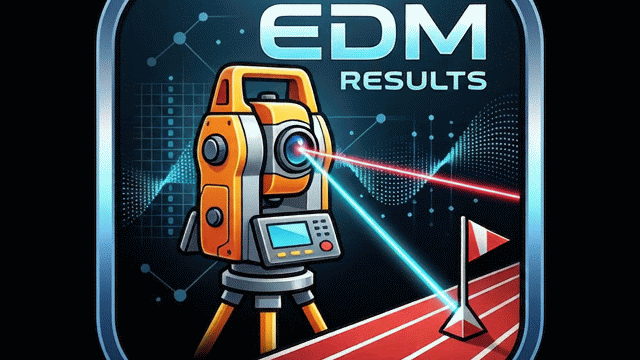

  

# EDM-Results
A software interface for connecting EDM / total stations via serial communication to automate measurement acquisition and real-time result processing in Track &amp; Field jump and throw events.

## Overview

This project provides an automated interface between electronic distance meters (EDM / Total Stations) and track and field meeting management systems for jump and throw field events.

### How It Works

1. **Instrument Communication:** Connects to the EDM via serial interface (RS-232/USB) using standard survey data protocols (e.g., Leica GSI or proprietary NMEA-like strings).
2. **Measurement Capture:** Intercepts real-time raw measurement data (slope distance, horizontal/vertical angles, or relative coordinates) upon target acquisition.
3. **Geometric Transformation:** 
   - Calibrates against fixed facility benchmarks (take-off board for Long/Triple Jump, center of the throwing circle or arc radius for Throws).
   - Computes the effective official distance along the competition sector axis.
4. **Rule-Compliant Formatting:** Automatically rounds down to the nearest centimeter in compliance with World Athletics competition rules.
5. **Data Dispatch:** Displays the verified performance instantaneously and exports results to local scoring tables or electronic scoreboards.# EDM-Results
A software interface for connecting EDM / total stations via serial communication to automate measurement acquisition and real-time result processing in Track &amp; Field jump and throw events.
---

## 📄 License

This project is licensed under the MIT License - see the [LICENSE](LICENSE) file for details.
